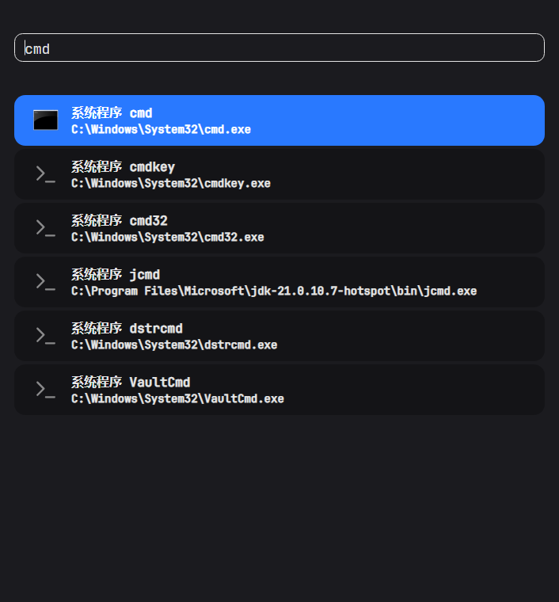

# CommandPark

> 面向 Windows 的键盘优先命令面板：敲几个字，回车，程序就打开了。



## 功能特性

### 搜索源

目前有三个来源，后续会继续增加：

- **PATH 程序搜索**：直接输入名字即可，在 `PATH`（以及 `System32`、`Windows`）里查找可执行文件。
  与系统查找语义一致——**只查目录本身、不递归**；同名程序按 `PATH` 顺序取第一个。
- **已安装程序**：搜索用户和所有用户的开始菜单快捷方式，支持名称、拼音、拼音首字母和目标程序名匹配。
  默认不加前缀也会搜索；使用 `ap:`、`app:` 或 `ia:` 前缀会让该来源的结果加权。
- **Everything 搜索**：用 `#` 或 `et:` 前缀触发，借助 [Everything](https://www.voidtools.com/)
  搜索全盘文件与文件夹（需要 Everything 处于运行状态）。

### 图标

- **程序**：读取可执行文件自带的图标（取系统能给出的最大尺寸）
- **文件 / 文件夹 / 驱动器**：系统图标（按文件类型，快捷方式会解析到目标的图标）
- **图片 / 视频 / PDF**：系统缩略图预览；没有缩略图时自动回落到文件图标
- 图标全部在后台线程加载、按类型缓存，并限制并发（最多 4 个），不阻塞界面；
  取不到时回落到默认图标，不会空一块

### 交互

- **相关度排序**：完全匹配 > 前缀 > 词边界/包含 > 模糊匹配；同分时短名称优先。例如输入 cmd 时，cmd.exe 会排在 jcmd.exe 前，即使后者所在目录在 PATH 中更靠前
- **流式结果**：拿到一批就显示一批，不等搜索全部结束
- **不闪白**：搜索期间保留上一次的结果，直到新结果到达才整体替换
- **不闪提示**：`搜索中` 只在超过 300ms 仍没有结果时才出现
- 输入有 120ms 防抖，连续快速输入只会在停顿后发起一次搜索
- 结果列表最多显示 200 条（避免超长列表拖慢界面）
- 执行失败**不会崩溃**：弹出错误窗口，用人话说明原因，并可展开完整堆栈跟踪

## 使用方法

### 快捷键

| 按键 | 作用 |
| --- | --- |
| 输入 | 实时搜索 |
| `↑` / `↓` | 选择上一条 / 下一条（到边界停住） |
| `Enter` | 执行选中项，**执行完成后关闭窗口** |
| `Ctrl` + `Enter` | 执行选中项，**不关闭窗口** |
| `Esc` | 关闭窗口 |

窗口打开后输入框自动获得焦点、结果默认选中第一条，全程可以只用键盘操作。

### 搜索示例

**1. 程序搜索（直接输入）**

```
cmd            打开 cmd.exe
notepad        打开 notepad.exe
git            打开 PATH 里第一个 git.exe
```

**2. 已安装程序搜索**

```text
ap:原神          匹配并加权开始菜单中的「原神」
app:vsc          匹配 Visual Studio Code 的首字母
ia:微信           使用 ia: 前缀同样会让已安装程序结果加权
```

**3. Everything 搜索（`#` 或 `et:` 前缀）**

前缀模式默认开启：只有带前缀才查 Everything，其余输入只走程序搜索。

```
#*.jpg C:\Windows       在 C:\Windows 下找 jpg（可用 Everything 的完整语法）
#ext:png file:           找所有 png 文件
et:report 2026           用 et: 前缀也一样
```


> 想让所有输入都走 Everything？把 `EverythingSource.PrefixMode` 设为 `false`。

### 执行失败时


- 常见错误会翻译成人话：`740` = 需要管理员权限、`1223` = UAC 被取消、`5` = 拒绝访问、文件不存在……
- 「显示堆栈跟踪」展开后是只读文本框，可选中复制
- `Enter` / `Esc` 关闭，`Tab` 切换焦点、`空格` 展开详情，全程键盘可操作

## 运行与构建

环境要求：

- Windows 10 / 11
- [.NET 10 SDK](https://dotnet.microsoft.com/download)
- （可选）[Everything](https://www.voidtools.com/) 1.4 及以上，用于文件搜索

```bash
# 运行
dotnet run --project src/CommandPark.Ui

# 构建
dotnet build

# 单元测试
dotnet test

# 发布（推荐：ReadyToRun 预编译，启动更快）
dotnet publish src/CommandPark.Ui -c Release -r win-x64 -p:PublishReadyToRun=true --self-contained true -o src/CommandPark.Ui/bin/Release/r2r-win-x64
```

### 启动速度

下表都是「进程启动 → 窗口可见」的实测值（同一台机器，各跑 5 次）：

| 构建方式 | 最快 | 中位 | 说明 |
| --- | --- | --- | --- |
| 框架依赖（默认发布） | 777ms | 781ms | 日常开发用的方式 |
| self-contained（未开 R2R） | 842ms | 855ms | 自带运行库，但启动要多从磁盘加载，反而更慢 |
| **ReadyToRun + self-contained** | **530ms** | **543ms** | 推荐发布方式，比默认发布快约 **30%** |

- 提速来自 **ReadyToRun（crossgen2 预编译 IL → 本机码）**，省掉启动时的 JIT；
  **首次运行**（文件还没进系统缓存）差距更明显：1381ms → 626ms。
- R2R 代码要求运行时补丁版本匹配，否则运行时会静默丢掉 R2R 代码回落到 JIT（提速就白费了），因此推荐配合 `--self-contained true`。
- **Native AOT 版本后续可能提供**：体积更小、冷启动更快，但必须在 **Windows + MSVC（VS Build Tools 的 C++ 工作负载）** 上构建——
  纯 Linux 构建机会直接报错 `Cross-OS native compilation is not supported`。

## 项目结构

```
CommandPark.slnx
src/
  CommandPark/                        # 核心库：Hint 模型、搜索源、图标抽象
    IHintIcon.cs                      # 图标抽象（程序图标 / 文件图标 / 缩略图 / 本地图片）
    HintProvider.cs                   # 多源并发搜索 + 分批回填
    Sources/EnvProgramSource.cs       # PATH 程序搜索
    Sources/EverythingSource.cs       # Everything 搜索（前缀触发）
    Sources/InstalledApplicationSource.cs       # 开始菜单已安装程序搜索
  CommandPark.Ui/                     # Avalonia 界面
    ProgramIconExtractor.cs           # 取程序自带的最大图标（PrivateExtractIcons）
    ShellIconExtractor.cs             # 系统文件图标 / 缩略图（IShellItemImageFactory）
    Win32BitmapConverter.cs           # HICON / HBITMAP → Avalonia 位图
    ViewModels/ParkMainViewModel.cs   # 搜索编排：防抖、取消、流式回填、选中与执行
    ViewModels/HintItemViewModel.cs   # 单条结果：图标、名称、执行命令
    Views/                            # 主窗口、搜索视图、结果条目、错误窗口
  CommandPark.Background/             # 后台常驻与全局热键监听（进行中）
  CommandPark.Tests/                  # 单元测试
docs/images/                          # README 截图
```

## 技术栈

- [Avalonia](https://avaloniaui.net/) 12 —— 跨平台 UI 框架
- [ShadUI](https://www.nuget.org/packages/ShadUI) —— 控件与主题（浅色 / 深色、亚克力背景、系统圆角）
- [Lucide.Avalonia](https://www.nuget.org/packages/Lucide.Avalonia) —— 矢量图标
- [CommunityToolkit.Mvvm](https://learn.microsoft.com/dotnet/communitytoolkit/mvvm/) —— MVVM 源生成器
- [EverythingSearchClient](https://www.nuget.org/packages/EverythingSearchClient) —— Everything IPC
- 内嵌 JetBrains Mono 字体（SIL OFL 1.1）

## 已知问题

- **Everything 的部分查询会阻塞不返回**（例如 `#ext:png file:` 这类宽泛查询）：客户端是阻塞式 IPC，
  取消令牌拦不住，界面会一直停在「搜索中」并占住一个线程池线程。计划改成「专用线程 + 超时隔离」。
- 程序图标的「最大尺寸」是**系统能给出的最大尺寸**（`PrivateExtractIcons` 会由 Shell 放大），
  不一定等于文件里真实存在的最大尺寸；要精确需要解析 `RT_GROUP_ICON`。
- 冷启动（首次运行、系统文件缓存未热）时 Avalonia 初始化明显变慢，与搜索逻辑无关。
- **快捷方式图标覆盖**：部分开始菜单快捷方式会通过 `IconLocation` 覆盖目标程序原始图标。当前优先显示快捷方式图标；后续需要增加检测或配置，让用户可以选择优先目标程序图标（[Issue #2](https://shrabbit.com:4000/gitlab/shrabbit/commandpark/-/work_items/2)）。

## 路线图

- [ ] 更多搜索源（浏览器书签 / 历史、计算器、进程、窗口……）
- [ ] `cp:` 前缀：查看与修改 CommandPark 自身配置
- [ ] 后台常驻 + 全局热键唤起（`CommandPark.Background` 进行中）
- [ ] 执行失败写入本地日志，便于事后排查
- [x] 结果按相似度排序（完全匹配优先，避免 `jcmd` 排在 `cmd` 前）
- [ ] 优化快捷方式图标覆盖策略（可选择优先目标程序图标，[Issue #2](https://shrabbit.com:4000/gitlab/shrabbit/commandpark/-/work_items/2)）
- [ ] Native AOT 版本（需要 Windows + MSVC 构建环境；体积更小、冷启动更快）

## 参与开发

```bash
git clone https://shrabbit.com:4000/gitlab/shrabbit/commandpark.git
cd commandpark
dotnet build
dotnet test
```

提交信息使用 **gitmoji + Conventional Commits**：

```
:sparkles: feat: 为 Everything 结果提供文件图标 / 程序图标 / 缩略图
:bug: fix(core): 修复 PATH 搜索递归枚举导致的异常中断
:memo: docs: 补充使用说明与截图
```

## 许可

尚未指定。
