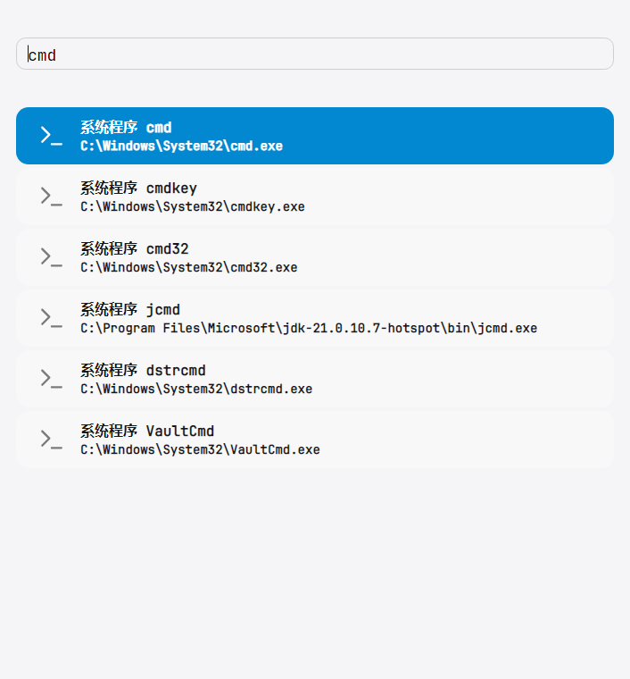

# CommandPark

> 面向 Windows 的键盘优先命令面板：敲几个字，回车，程序就打开了。


## 功能特性

### 搜索源

CommandPark 当前包含七个来源。除首屏欢迎项外，它们会并发参与搜索，并按相关度排序。

| 来源 | 触发方式 | 说明 |
| --- | --- | --- |
| PATH 程序 | 直接输入 | 在 `PATH`、`System32` 和 `Windows` 中查找 `.exe`；每个程序名只取 PATH 中第一个。 |
| 已安装程序 | 直接输入 | 搜索用户和所有用户的开始菜单快捷方式，支持名称、拼音、拼音首字母和目标程序名。 |
| Everything | `#` 或 `et:` | 通过 Everything 搜索全盘文件、文件夹和驱动器，需要 Everything 正在运行。 |
| 运行命令 | `@`、`run:`、`r:` | 运行输入的命令；默认使用 `runas` 启动，可能触发 UAC。 |
| 计算 | `~`、`c:`、`calc:` | 使用 AngouriMath 计算表达式；推荐使用 `c:` 或 `calc:`。 |
| Bing | `b:`、`bs:` | 搜索 Bing，并把 Bing 关键词建议作为候选结果。 |
| 首屏欢迎 | 空查询 | 运行实现 `IHomeDisplayable` 的来源，输入任意内容后自动隐藏。 |

- **PATH 程序搜索**只查目录本身，不递归子目录，避免扫描整个 `C:\Windows`。
- **已安装程序**默认无前缀也会搜索；`ap:`、`app:`、`ia:` 会给本源结果加权。
- **Everything** 默认只在带 `#` / `et:` 前缀时运行；可在配置中关闭 `everything.prefixMode`。
- **运行命令**默认无前缀时作为低优先级兜底；可在配置中设置 `run.prefixMode`。
- **计算**支持超时与取消；`c:` / `calc:` 在成功、错误和超时情况下都会保留 Desmos 跳转项。
- **Bing**仅在 `b:` / `bs:` 前缀下运行，会先返回精确搜索项，再返回关键词建议。
- **首屏欢迎**由 `welcome` 配置节控制，首屏操作也可以直接用键盘选择和执行。

### 后台常驻与全局热键

`CommandPark.Background.Cpp.exe` 是常驻的小型 Win32 C++ 守护进程，负责注册全局快捷键和托盘图标；
它由主程序按需拉起，构建时会复制到主程序旁边。

- 主程序启动时读取程序目录下的 `PID` 判断后台是否已经在运行（进程是否还活着、是否是本后台程序）：
  - 后台**未运行** → 这次启动**只拉起后台程序**，弹一次「已在后台启动」提示，不显示输入窗口，然后直接退出（相当于“注册热键”）。
  - 后台**已在运行** → 正常显示输入窗口。
- 之后按下快捷键（默认 `Ctrl+Alt+D`），或再次双击主程序，都会唤起搜索窗口。
- 快捷键格式为「修饰符+按键」，例如 `Ctrl+Alt+Space`、`Win+Shift+S`、`Ctrl+F12`，至少需要一个修饰键。
- 托盘图标右键菜单提供「修改配置」和「退出」；「修改配置」用默认程序打开 `commandpark.json`，资源管理器重启后会自动重建托盘图标。
- 启动参数带 `--no-display` 时不弹「已在后台启动」提示，适合放进开机自启动。
- `hotkey` 不填时使用默认值 `Ctrl+Alt+D`；显式写 `null` 时不拉起后台程序，双击直接运行主程序。
- 后台不可用（后台程序缺失、`hotkey` 为 `null`、后台启动失败等）时，主程序照常显示输入窗口，并在首屏欢迎项**最后**追加一条提示。

> “程序目录”指主程序与后台程序所在目录，`PID` 与 `commandpark.json` 都在这里查找。

### 点击权重

CommandPark 会把「id + 标题 + 描述」拼起来做 SHA256，只在本地记录每个摘要的点击次数：

- 执行或查看详情都会让该条目的计数 +1，下次搜索时按点击次数加权，点击越多越靠前。
- 记录写在本机的 `commandpark.clicks.htt`（默认位于 `%LOCALAPPDATA%\CommandPark\`），程序启动时读取、退出时写回。
- 文件是二进制格式，每条记录只有 32 字节摘要 + 4 字节计数；不含任何明文，无法反推用户点过什么。
- 默认最多保留 10000 条，超过后从最旧的记录开始删除；可用 `clicks.maxEntries` 调整。

> 上面描述的哈希、加权公式、htt 二进制格式与隐私边界，详见下文「内部说明」。

### 主题

支持深色、浅色和跟随系统；由 `commandpark.json` 顶层的 `theme` 控制。

在 Windows 上启用 `AcrylicBlur` / `Mica` / `Blur` 透明层级后，窗口背景会呈现系统级模糊：


### 图标

- **程序**：读取可执行文件自带的图标（取系统能给出的最大尺寸）
- **文件 / 文件夹 / 驱动器**：系统图标（按文件类型，快捷方式会解析到目标的图标）
- **图片 / 视频 / PDF**：系统缩略图预览；没有缩略图时自动回落到文件图标
- 图标全部在后台线程加载、按类型缓存，并限制并发（最多 4 个），不阻塞界面；
  取不到时回落到默认图标，不会空一块

### 交互

- **相关度排序**：完全匹配 > 前缀 > 词边界/包含 > 模糊匹配；同分时短名称优先。例如输入 cmd 时，cmd.exe 会排在 jcmd.exe 前，即使后者所在目录在 PATH 中更靠前
- **点击权重**：执行或查看过的条目点击越多，之后的搜索里排序越靠前；只在本机保存摘要与次数（见上文「点击权重」）
- **流式结果**：拿到一批就显示一批，不等搜索全部结束
- **不闪白**：搜索期间保留上一次的结果，直到新结果到达才整体替换
- **不闪提示**：`搜索中` 只在超过 300ms 仍没有结果时才出现
- 输入有 120ms 防抖，连续快速输入只会在停顿后发起一次搜索
- 结果列表最多显示 200 条（避免超长列表拖慢界面）
- 执行失败**不会崩溃**：弹出错误窗口，用人话说明原因，并可展开完整堆栈跟踪

## 使用方法

### 快捷键

| 按键 | 作用 |
| --- | --- |
| 输入 | 实时搜索 |
| `↑` / `↓` | 选择上一条 / 下一条（到边界停住） |
| `Enter` | 执行选中项，**执行完成后关闭窗口** |
| `Ctrl` + `Enter` | 执行选中项，**不关闭窗口** |
| `Esc` | 关闭窗口 |

窗口打开后输入框自动获得焦点、结果默认选中第一条，全程可以只用键盘操作。

### 搜索示例

**1. 程序搜索（直接输入）**

```
cmd            打开 cmd.exe
notepad        打开 notepad.exe
git            打开 PATH 里第一个 git.exe
```

**2. 已安装程序搜索**

```text
ap:原神          匹配并加权开始菜单中的「原神」
app:vsc          匹配 Visual Studio Code 的首字母
ia:微信           使用 ia: 前缀同样会让已安装程序结果加权
```

**3. Everything 搜索（`#` 或 `et:` 前缀）**

前缀模式默认开启：只有带前缀才查 Everything，其余输入只走程序搜索。

```
#*.jpg C:\Windows       在 C:\Windows 下找 jpg（可用 Everything 的完整语法）
#ext:png file:           找所有 png 文件
et:report 2026           用 et: 前缀也一样
```


> 想让所有输入都走 Everything？在 `commandpark.json` 中把 `everything.prefixMode` 设为 `false`。

**4. 运行命令（`@` / `run:` / `r:` 前缀）**

```text
@notepad
run:"C:\Program Files\Example\app.exe"
r:cmd /c echo hello
```

运行命令会通过 `runas` 启动，因此可能触发 UAC。

**5. 计算与 Desmos 跳转（`c:` / `calc:` 前缀）**

普通表达式会先计算结果，再提供 Desmos 跳转项：

```text
c:i^2
```

结果会显示 `= -1`，同时出现“在 Desmos 中打开”。选中计算结果按 `Enter` 查看详情，详情窗口按 `Alt+D` 可直接打开 Desmos。


图表表达式会通过 `Latexize()` 转换为 LaTeX 后生成 Desmos 快照：

```text
calc:y=x^{7}+\sin\frac{62}{6}x
```


[在 Desmos 中查看这张图](https://www.desmos.com/calculator/ldguqxfiie)

> 计算源使用 `~`、`c:`、`calc:` 前缀；需要明确的计算/Desmos 跳转时，建议使用 `c:` 或 `calc:`。

计算默认超时时间为 2 秒；无论表达式成功、失败还是超时，`c:` / `calc:` 都会保留 Desmos 跳转 Hint。

**6. Bing 搜索（`b:` / `bs:` 前缀）**

```text
b:CommandPark
bs:CommandPark Github
```

Bing 源会先显示输入内容的精确搜索项，然后异步加载并显示 Bing 关键词建议；建议项同样可以直接按 Enter 搜索。


### 配置文件

程序目录中的 `commandpark.json` 用于配置搜索源；程序也会兼容读取同目录下的 `config.json`。
`commandpark.schema.json` 是同一目录下的 JSON Schema，支持编辑器和 IDE 自动补全与校验。

```json
{
  "$schema": "./commandpark.schema.json",
  "theme": "auto",
  "hotkey": "Ctrl+Alt+D",
  "clicks": {
    "maxEntries": 10000
  },
  "sources": {
    "envProgram": {},
    "everything": {
      "prefixMode": true,
      "batchSize": 4
    },
    "installedApplication": {
      "prefixMode": false,
      "skipNoise": true,
      "pinyinMode": true,
      "maxLength": 64,
      "excludes": ["Uninstall"]
    },
    "run": {
      "prefixMode": false
    },
    "latexCalc": {
      "prefixMode": true,
      "timeoutSeconds": 2
    },
    "bing": {
      "prefixMode": true
    },
    "welcome": {
      "showEditConfig": true,
      "showRepo": true,
      "showOfficial": true
    }
  }
}
```

| 深色 | 浅色 |
| --- | --- |
|  |  |

- `theme`：`auto`、`light` 或 `dark`；为 `null` 或不填写时跟随系统，默认值也是 `auto`。
- `hotkey`：后台程序监听的全局快捷键，默认 `Ctrl+Alt+D`；显式写 `null` 时不启动后台热键监听。
- `clicks.maxEntries`：本地最多保留的点击记录条数，默认 `10000`，范围 1..1000000；超过后从最旧的记录开始删除。
- 文件不存在时使用内置默认值，所有内置源都会启用。
- 文件存在时，未提供配置节的 `IConfigReader` 源不会运行。
- `envProgram`：提供空对象即启用 PATH 程序搜索。
- `everything.prefixMode`：是否只在输入 `#`、`et:` 前缀时运行 Everything。
- `everything.batchSize`：每次从 Everything 请求的结果数，范围 1..1000。
- `installedApplication.prefixMode`：为 `true` 时只有输入 `$`、`ap:`、`app:` 或 `ia:` 前缀才运行该源。
- `installedApplication.skipNoise`：是否过滤卸载、说明、网站等快捷方式。
- `installedApplication.pinyinMode`：是否启用连续拼音和拼音首字母匹配。
- `installedApplication.maxLength`：名称超过该长度时视为描述型噪声。
- `installedApplication.excludes`：额外排除的名称或路径关键字。
- `run.prefixMode`：为 `true` 时只有输入 `@`、`run:` 或 `r:` 前缀才运行任意命令。
- `latexCalc.prefixMode`：为 `true` 时只有输入 `~`、`c:` 或 `calc:` 前缀才运行计算源。
- `latexCalc.timeoutSeconds`：单次计算超时时间，范围 1..30 秒。
- `bing.prefixMode`：`true` 时只有输入 `b:` 或 `bs:` 才运行 Bing 搜索源。
- `welcome.showEditConfig`：是否显示修改配置文件的欢迎项。
- `welcome.showRepo`：是否显示项目仓库入口。
- `welcome.showOfficial`：是否显示 shRabbit 官方网站入口。

> 修改配置结构时必须同步修改 `commandpark.schema.json`，否则编辑器校验会与实际配置不一致。

### 执行失败时


- 常见错误会翻译成人话：`740` = 需要管理员权限、`1223` = UAC 被取消、`5` = 拒绝访问、文件不存在……
- 「显示堆栈跟踪」展开后是只读文本框，可选中复制
- `Enter` / `Esc` 关闭，`Tab` 切换焦点、`空格` 展开详情，全程键盘可操作

## 运行与构建

环境要求：

- Windows 10 / 11
- [.NET 10 SDK](https://dotnet.microsoft.com/download)
- （可选）[Everything](https://www.voidtools.com/) 1.4 及以上，用于文件搜索

```bash
# 运行
dotnet run --project src/CommandPark.Ui

# 构建
dotnet build

# 单元测试
dotnet test

# 发布（推荐：ReadyToRun 预编译，启动更快）
dotnet publish src/CommandPark.Ui -c Release -r win-x64 -p:PublishReadyToRun=true --self-contained true -o src/CommandPark.Ui/bin/Release/r2r-win-x64
```

### 后台程序（C++）

`CommandPark.Background.Cpp` 是独立的 Win32 C++ 项目，需要 Visual Studio 的 MSVC 工具链；
Release 配置默认开启 `/O2`、内联与 LTCG（Whole Program Optimization）：

```bash
# 构建后台程序；产物在 src/CommandPark.Background.Cpp/bin/<Platform>/<Configuration>/
msbuild src/CommandPark.Background.Cpp/CommandPark.Background.Cpp.vcxproj -p:Configuration=Release -p:Platform=x64

# 再构建主程序：会把同配置的 CommandPark.Background.Cpp.exe 复制到主程序输出目录
dotnet build src/CommandPark.Ui -c Release
```

> 主程序按 `bin/x64/$(Configuration)/` 查找后台程序，找不到就跳过（仍能启动，只是没有全局热键）；
> 平台可用 `-p:CommandParkBackgroundPlatform=Win32` 覆盖。

### 启动速度

下表是「进程启动 → 窗口可见」的实测值（2026-09-29，同一台机器、重启后各跑 5 次）：

| 构建方式 | 各次耗时 | 最快 | 中位 | 最慢 | 发布目录大小 |
| --- | --- | ---: | ---: | ---: | ---: |
| ReadyToRun + self-contained | 491 / 454 / 458 / 450 / 461ms | 450ms | **458ms** | 491ms | ~1.13GB |
| **Native AOT** | 243 / 221 / 254 / 238 / 238ms | **221ms** | **238ms** | 254ms | ~153MB |

- 日常开发用框架依赖发布即可；正式发布推荐 **ReadyToRun（crossgen2 预编译 IL → 本机码）+ self-contained**，
  省掉启动时的 JIT，比框架依赖发布快约 30%，首次冷缓存运行差距更明显。
- R2R 代码要求运行时补丁版本匹配，否则会静默回落到 JIT、提速失效，因此推荐配合 `--self-contained true`。
- **Native AOT** 比 R2R 发布再快约 **48%**，发布目录也更小；首次冷缓存运行可能明显更慢。
- 当前 AOT 发布仍会报告 COM P/Invoke、Everything、RestSharp 等 trimming/AOT 警告，需要继续做功能回归。
- `DesmosHelper` 的 DTO 已使用 `DesmosJsonContext` 的 source-generated JSON 元数据，避免反射序列化路径。

发布命令：

```bash
dotnet publish src/CommandPark.Ui -c Release -r win-x64 -p:PublishReadyToRun=true --self-contained true -o src/CommandPark.Ui/bin/Release/r2r-win-x64

# 或 Native AOT
dotnet publish src/CommandPark.Ui -c Release -r win-x64 `
  -p:PublishAot=true `
  -p:OptimizationPreference=Speed `
  -p:StackTraceSupport=false `
  -p:DebugType=None -p:DebugSymbols=false `
  -o src/CommandPark.Ui/bin/Release/aot-win-x64
```

## 内部说明

### 点击权重（htt）

**它解决什么**：在原有相关度排序之上叠加「用户更常点哪一条」的偏好，让常用命令逐步上浮。

**哈希**：把 `id + 0x1F + 标题 + 0x1F + 描述` 按 UTF-8 编码后做 SHA256，取 32 字节摘要作为键。
字段之间用 ASCII Unit Separator 分隔，避免 `("ab","c")` 与 `("a","bc")` 拼出同一个摘要。

**htt 二进制格式**：每条记录固定 36 字节 = 32 字节摘要 + 4 字节小端 int 计数；
可寻址与不可寻址流都能顺序读写，读写用 `ArrayPool` 分块批处理，逐条不产生额外分配。
文件默认写在 `%LOCALAPPDATA%\CommandPark\commandpark.clicks.htt`（无权限时回落程序目录），
先写 `*.tmp` 再原子替换，避免退出阶段崩溃留下半个文件。

**排序加权**：`bonus = min(点击数 × 0.05, 0.25)`，搜索结果按 `Similarity + bonus` 降序；
未命中或没有记录时为 0，因此未启用权重时仍是原来的纯相似度排序。

**容量与淘汰**：默认最多 10000 条，可用 `clicks.maxEntries`（1..1000000）配置；
超过上限时按「首次插入顺序」从最旧记录开始淘汰（FIFO），写回文件保持同一顺序。

**生命周期与并发**：程序启动时读取、退出时写回；UI 线程计点击、搜索线程读权重，
`HintClickStore` 用锁保护内部映射，`HintProvider` 在排序时调用 `IHintWeightProvider.GetWeight`。

### 安全性

- **不存明文**：本地只保存 SHA256 摘要与整数计数，文件里没有 id / 标题 / 描述，无法由 `.htt` 直接还原点击内容。
- **单向哈希**：SHA256 不可逆，且摘要以 4 个 `ulong` 结构承载，作为字典键时不产生 `byte[]` 分配。
- **仅本机**：不联网、不上传，只写入 `%LOCALAPPDATA%`（无权限时回落程序目录）。
- **可删除即清空**：删除 `.htt` 文件即重置全部点击偏好，不残留其它痕迹。
- **边界**：若已知候选项集合，仍可逐个计算摘要去比对计数（字典比对），因此它只是本机偏好数据，
  不是「抗穷举」的匿名化或加密存储；应把它当作可随时删除的本地缓存。

## 技术栈

- [Avalonia](https://avaloniaui.net/) 12 —— 跨平台 UI 框架
- [ShadUI](https://www.nuget.org/packages/ShadUI) —— 控件与主题（浅色 / 深色、亚克力背景、系统圆角）
- [Lucide.Avalonia](https://www.nuget.org/packages/Lucide.Avalonia) —— 矢量图标
- [CommunityToolkit.Mvvm](https://learn.microsoft.com/dotnet/communitytoolkit/mvvm/) —— MVVM 源生成器
- [EverythingSearchClient](https://www.nuget.org/packages/EverythingSearchClient) —— Everything IPC
- [AngouriMath](https://am.angouri.org/) —— 表达式求值与 LaTeX 转换
- [RestSharp](https://restsharp.dev/) —— Desmos 快照请求
- [Lnk](https://www.nuget.org/packages/Lnk) —— 解析开始菜单快捷方式（.lnk）的目标路径、参数与图标
- [NPinyin.Core](https://www.nuget.org/packages/NPinyin.Core) —— 中文拼音与拼音首字母匹配
- 内嵌 JetBrains Mono 字体（SIL OFL 1.1）

## 已知问题

- **Everything 的部分查询会阻塞不返回**（例如 `#ext:png file:` 这类宽泛查询）：客户端是阻塞式 IPC，
  取消令牌拦不住，界面会一直停在「搜索中」并占住一个线程池线程。计划改成「专用线程 + 超时隔离」。
- 程序图标的「最大尺寸」是**系统能给出的最大尺寸**（`PrivateExtractIcons` 会由 Shell 放大），
  不一定等于文件里真实存在的最大尺寸；要精确需要解析 `RT_GROUP_ICON`。
- 冷启动（首次运行、系统文件缓存未热）时 Avalonia 初始化明显变慢，与搜索逻辑无关。
- **浅色主题对比度**：部分控件或状态下，浅色主题的文字与背景对比度仍然偏低，后续会逐项调整。
- **快捷方式图标覆盖**：部分开始菜单快捷方式会通过 `IconLocation` 覆盖目标程序原始图标。当前优先显示快捷方式图标；后续需要增加检测或配置，让用户可以选择优先目标程序图标（[Issue #2](https://shrabbit.com:4000/gitlab/shrabbit/commandpark/-/work_items/2)）。

## 路线图

- [ ] 更多搜索源（浏览器书签 / 历史、进程、窗口……）
- [ ] `cp:` 前缀：查看与修改 CommandPark 自身配置
- [ ] 执行失败写入本地日志，便于事后排查
- [ ] 优化快捷方式图标覆盖策略（可选择优先目标程序图标，[Issue #2](https://shrabbit.com:4000/gitlab/shrabbit/commandpark/-/work_items/2)）

## 参与开发

```bash
git clone https://shrabbit.com:4000/gitlab/shrabbit/commandpark.git
git lfs pull
cd commandpark
dotnet build
dotnet test
```

提交信息使用 **gitmoji + Conventional Commits**：

```
:sparkles: feat: 为 Everything 结果提供文件图标 / 程序图标 / 缩略图
:bug: fix(core): 修复 PATH 搜索递归枚举导致的异常中断
:memo: docs: 补充使用说明与截图
```

## 许可

尚未指定。
